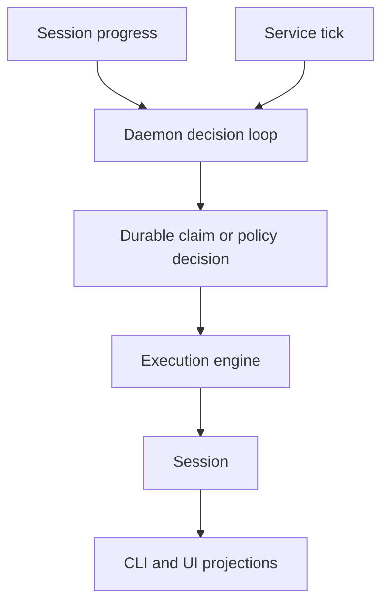

# Automation

The daemon is the sole scheduler for watchdog passes and periodic maintenance. UI clients
may request an action or render state; they never own an acting timer.



## Scheduled agent work

The CLI has no job scheduler. Run recurring agent work from the OS scheduler (cron, a
systemd timer, or launchd) and have it invoke `agents run` headlessly:

```cron
0 9 * * 1-5 cd ~/src/app && agents run claude "Review yesterday's PRs" --mode plan
```

Each fire is an ordinary `agents run`, so it gets the same env build, version-home
isolation, account rotation, and session indexing as a run started by hand. A job that
drains shared input (a tracker, a PR queue) belongs on one device only, per
[§Scheduling & execution singularity](specifications.md#scheduling--execution-singularity)
SING-9.

## Watchdog

The watchdog reads fleet progress, classifies non-progressing unfinished sessions, asks a
real decider for an action, delivers to the exact session, and records confirmation. Hard
account limits may rotate in place, preserving tab and conversation context. Detection is
fleet-wide; delivery remains local to the owning device.
