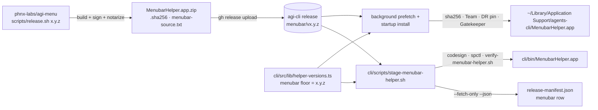

<!-- guide -->
# Menu bar (AGI Menu) — the cross-repo contract

The macOS menu-bar helper is **AGI Menu**. Its source, behavior, and internals
live in their own repo, [phnx-labs/agi-menu](https://github.com/phnx-labs/agi-menu)
(private; split out of `cli/menubar/` on 2026-09-10, PHNX-4036). Everything
about what the helper *does* — the dropdown, the quick-issue bar, the Sessions
window, notifications, the daemon-down watchdog, the single-instance lock, the
bounded child spawner, the self-tests — is documented there:

- [agi-menu `docs/menubar.md`](https://github.com/phnx-labs/agi-menu/blob/main/docs/menubar.md)
- [agi-menu `AGENTS.md`](https://github.com/phnx-labs/agi-menu/blob/main/AGENTS.md)

This page is the **contract between the two repos**: what agents-cli consumes,
at which address, and what each side must not change.

## What agents-cli consumes

| Item | Value | Where it is pinned |
|---|---|---|
| Release repo + tag | `phnx-labs/agi-cli`, tag **`menubar/v<x.y.z>`** (this public repo; agi-menu is private, an installed CLI downloads anonymously) | `HELPER_RELEASE_REPO` in `src/lib/helper-download.ts`; `helperTag('menubar', …)` in `src/lib/helper-versions.ts` |
| Assets | `MenubarHelper.app.zip` (`ditto -c -k --keepParent`, so `MenubarHelper.app/` is the top-level entry), `MenubarHelper.app.zip.sha256` (`<hex>  MenubarHelper.app.zip`), `menubar-source.txt` (provenance: `repo=`/`commit=`/`tag=`/`version=`; absent on releases cut before the split) | `MENUBAR_HELPER_ASSET` in `src/lib/menubar/download-menubar.ts`; `parseSha256Asset` in `src/lib/sha256-asset.ts` |
| Floor | the `menubar` entry in `HELPER_RELEASES` — the build this CLI was tested against; resolution may pick newer, never older | `src/lib/helper-versions.ts` |
| Bundle folder | `MenubarHelper.app` | `MENUBAR_HELPER_APP_NAME` |
| Executable | `AGI Menu` (what Accessibility settings and the "would like to control this computer" prompt show) | `MENUBAR_HELPER_EXECUTABLE_NAME` in `src/lib/menubar/install-menubar.ts` |
| Bundle id | `com.phnx-labs.agents-menubar` (a dev build signs as `….dev`) | `MENUBAR_HELPER_BUNDLE_ID`, `SERVICE_LABEL_BASE` |
| Signer | Developer ID, Team `2HTP252L87`, notarized + stapled | `EXPECTED_TEAM_ID` in `src/lib/helper-download.ts` |
| Designated requirement | `identifier "com.phnx-labs.agents-menubar" … certificate leaf[subject.OU] = "2HTP252L87"` | `verifyDesignatedRequirement`; `scripts/verify-menubar-helper.sh` |
| Snapshot feed | `agents menubar snapshot --json` (read-only; same rows and status words as `agents ps --local --json`) | `src/lib/menubar/snapshot.ts`, `src/commands/menubar.ts` |
| Preferences | `snapshot.menuPreferences` — every `menubar.menu.*` and `menubar.statusbar.*` key's effective value; written one at a time with `agents config set/unset`. A key with no registered default (`defaultProject`, `todoProject`, `headlessAgent`, `headlessFallbackAgent`) is OMITTED when unset, so the menu keeps its own default. `menubar.statusbar.goalCountdown` (bool, default `false`) rides this map too. The list keys (`pinnedProjects`, `tabOrder`, `hiddenTabs`, `homeGoals`, `homeSections`, `artifactApps`, `githubHidden`) are NOT in this map: they ride `snapshot.menuListPreferences` (same keys, JSON arrays, same default rule), because shipped menus decode `menuPreferences` as scalars and one array would fail the whole snapshot. The menu writes one as a JSON array argument (`agents config set menubar.menu.pinnedProjects '["Rush"]'`), so any project name round-trips | `MENUBAR_CONFIG_KEYS` in `src/lib/config-keys.ts`; the specs in `src/lib/device-config.ts` |
| Device facts | each `snapshot.devices[]` row: `name`, `platform`, `formFactor`, `interactive`, `isLocal`, `preferred`, `role`, `autoEligible`, and `stats` (`null` when never measured) | `src/lib/menubar/snapshot.ts` |
| Signed-in person | `snapshot.me`: `{name, email, github, avatarUrl, avatarSource}` or `null` when neither source knows anyone. One person, never a blend: with a Phoenix ID session (`agents auth login`) the session supplies `name`, `email` and the picture (https only), and the `gh` account adds `github` (plus a fallback name and picture) only when its public profile email equals the session email; without a session the `gh` account supplies everything but `email`. No picture → `avatarUrl: null` (draw initials); `avatarSource` is `phoenix` \| `github` \| `null`. Local reads only: the Phoenix session file and the `gh api user` record at `~/.agents/.cache/github-viewer.json` (no email; a SHA-256 of the public one). The snapshot spawns `gh` only when that record is stale (a day after a success, an hour after a failure, which keeps the last good viewer), capped at 5 s, inside the menu's 30 s snapshot deadline. `email` exists only in this local JSON | `resolveMenubarMe` in `src/lib/menubar/snapshot.ts`; `cachedViewer` in `src/lib/github/viewer.ts` |
| Project grouping | `confirmedProject` on every session row (`agents feed watch --json`, `agents ps watch --json`, `agents ps --json`): the registered project (a former name listed in a definition's `aliases:` reads as the current name), or `null` for Uncategorized. A cwd recorded under the same user's home on another box (`/home/<user>/…` from a Linux worker, `/Users/<user>/…` from a Mac, `<user>` being this home's own name) matches as the same path under this home; `/Users/Shared` and other users' homes are left alone, so a worker's session lands in the same project as a local one | `confirmedProjectForCwd` in `src/lib/projects.ts`; `localizeHome` in `src/lib/project-root.ts` |
| Waiting on itself | `pending` on a live session row: `{subagents, shells, monitors}`, each `[{id, description, startedAtMs}]`, only work running now, absent when none. Show `status: "idle"` with `pending` as Waiting, not as needing you; `subAgentCount` is cumulative. `effort` (`low`/`medium`/`high`/`xhigh`/`max`) and `fast` ride the same row when the transcript records them | `src/lib/session/pending-work.ts` |
| Open a session | `agents ps focus <id>`, run as a detached child with no TTY. It focuses the session's live tab or pane when it has one. A session running headless is stopped first (`agents ps stop <id> --local` on its own device) so the resumed tab is its only writer, and if that device cannot be reached or its `ps stop` fails, nothing opens. If the tab then fails to open, the error says the headless run was stopped and gives `agents run auto --resume <id>`. The new tab goes where the live roster's sessions run (`resolveLaunchBackend`): with VSCodium sessions, a tab in the project's VSCodium window. A session owned by another device opens a local tab running `agents run auto --resume <id> --interactive`, which hops to the owner. A session that has ended (a card closed in the last day) opens in a tab the same way rather than resuming inside the menu's detached child; with no drivable terminal, focus exits 1 and says so. If VSCodium never confirms the tab (usually its one-time "Allow 'Agents' extension to open this URI?" prompt), focus exits 1 with that reason on stderr | `resumeInTab` in `src/commands/focus.ts`; `src/lib/terminal/preferred.ts` |
| To-dos | `agents projects todo list --json`, scoped with `--project <menubar.menu.todoProject>` when that key is set: the project's open Linear issues, due ones first, then the newest, at most 6, with `total` the full count. Unset, it is the viewer's quick to-dos plus anything due. New to-dos go to the same project with `agents projects todo add … --project <name>` | `src/lib/quick-todo.ts`; `src/commands/projects-todo.ts` |
| Tabs | `MENUBAR_TABS` is `home`, `goals`, `secrets`, `linear`, `github`, `sessions`, `inbox`; Settings is always last. The Projects tab is retired: `projects` is no longer in the default `tabOrder` or required in one, but an order or `hiddenTabs` list that names it is still accepted and reads back with it in place, so a menu that predates the removal keeps working | `MENUBAR_TABS`, `MENUBAR_RETIRED_TABS` and the specs in `src/lib/device-config.ts` |
| Linear tab and Sessions kinds | The Linear tab is `linear` in `tabOrder`/`hiddenTabs` (shown by default; an order saved before it existed reads back with it appended). It reads the same `linear projects overview --json` the Projects tab does and moves a ticket with `linear update <id> --status <state>`, a state name from `linear states --json`. `menubar.menu.showBrowserSessions` and `showComputerSessions` (bools, default `true`) decide whether the Sessions tab lists browser tasks and computer runs; with both off it lists agents only. `menubar.menu.ticketGroup` (`none` \| `status` \| `due` \| `assignee` \| `delegate` \| `milestone` \| `priority`) is how both ticket lists group, and `menubar.menu.ticketSort` (`due`, the default \| `priority` \| `updated` \| `newest` \| `oldest` \| `title`) is how they sort. `menubar.menu.homeSections` (Home's sections in order, a leading `-` hiding one) arranges Home, `menubar.menu.sessionFilter` is the one filter Home's Open sessions and the Sessions tab share, and `menubar.menu.artifactApps` (`<kind>=<bundle id>`) is the app each artifact kind opens with. The project the header picker scopes every tab to is `menubar.menu.defaultProject` (unset = All projects) | `MENUBAR_TABS` and the specs in `src/lib/device-config.ts` |
| GitHub tab | `agents projects prs --json` with no project name: every open PR across the viewer's account and orgs (`owners[]`), grouped per repository with the `projects` that attach it, each PR with `reviewRequested` and `needsMe` (`review`, `failing`, `conflicts`, or null). The card's actions are the same `projects prs` verbs with the project name left out (`comment`, `review --approve`, `merge`, and `merge --admin` for "Merge past checks…", offered only where `merge.viewerIsAdmin` and `merge.adminBypass`). The tab is `github` in `tabOrder`/`hiddenTabs`; what it watches is `menubar.menu.githubHidden` (org logins or `owner/repo` slugs), `githubDrafts` (default `true`, drafts shown) and `githubBots` (default `false`) | `src/lib/github/open-prs.ts`; `prs` in `src/commands/projects.ts` |

The **designated requirement is load-bearing**: macOS keys the helper's
Accessibility (TCC) grant to it and re-validates every new version against it.
A release whose DR drops the bundle id or the Team — an ad-hoc signature, a
different identity, a CDHash-pinned requirement — silently revokes every user's
grant and re-prompts them on the next paste. Both `download-menubar.ts` (before
install) and `scripts/verify-menubar-helper.sh` (after staging) refuse such a
bundle.

## How a build reaches a user



1. **Publish** (in agi-menu, on a Mac with the signing identity):
   `secrets exec apple.com -- scripts/release.sh <x.y.z>`. Helper releases
   are immutable — the script refuses an already-published tag.
2. **Pin** (here): bump `menubar` in `src/lib/helper-versions.ts` to `<x.y.z>`.
   The tag makes the build downloadable; the floor is what makes a CLI ask for
   it. The floor file is also the helper's **release-manifest input**, so the
   bump is what makes `scripts/release-attestation-produce.sh --with-helpers`
   re-record the row from the published asset.
3. **Install** (on a user's Mac): automatic. The background sync worker
   (`prefetchMenubarHelper`) downloads and verifies the floor build into the
   release cache, and the next `agents` command installs the login item from it
   (`installMenubarLaunchAgentOnUpgrade`). Both skip a Mac where
   `menubar.enabled` is false. No build happens on any user machine.
4. **Update, unattended.** Installed release helpers move to the newest
   published build on their own: `resolveMenubarVersion`
   (`src/lib/menubar/resolve-version.ts`) finds it about twice a day over plain
   github.com, never api.github.com, whose 60-requests-an-hour unauthenticated limit a
   shared IP exhausts. One git protocol v2 `ls-refs` POST to
   `github.com/phnx-labs/agi-cli.git/git-upload-pack` lists only the `menubar/v*` tags
   (about 4.6 KB). Then the newest strict `x.y.z` tag above the floor is confirmed with a
   HEAD of its `MenubarHelper.app.zip` and `.sha256` download URLs. A 404 on either one
   (a draft, or a tag whose upload has not finished) moves on to the next tag. Pre-releases
   are excluded by tag shape: agi-menu's `release.sh` marks a release `--prerelease`
   exactly when its tag carries `-pre.N`. The answer is cached at
   `~/.agents/.cache/menubar/latest.json` and never falls below the floor. Update checks
   surface network errors. `updateMenubarHelperIfNewer` downloads
   and verifies that build, swaps it atomically at the same path and identity
   (bundle id + Team, so the Accessibility grant survives), and restarts the
   helper. Automatic attempts honor `menubar.autoUpdate` and one persistent 12-hour gate.
   Triggers include the daemon's periodic self-heal check `menubar-helper`
   (every six hours; `agents doctor` shows it, `agents sync` runs it)
   and the end of `agents upgrade`. A local-build install, an opted-out Mac and
   a Mac that never enabled the menu bar are left alone; the multi-install
   ownership contest still applies, judged on the build just downloaded (its
   Developer ID signature and version), never on a cached copy that may not
   exist yet; a newer signed release therefore upgrades from any install. A
   dry run (`agents doctor`) downloads nothing, so it reports the update it
   would attempt, not whether this install would win the contest. The floor bump in step 2 is therefore the
   *tested-against* record and the offline answer, not the release switch.

### Staging a bundle in this repo

```bash
cli/scripts/stage-menubar-helper.sh                 # macOS: download, verify, extract to cli/bin/MenubarHelper.app
cli/scripts/stage-menubar-helper.sh --fetch-only    # any OS: download + sha256-verify only
cli/scripts/stage-menubar-helper.sh --json          # machine-readable {floor, tag, assetUrl, zip, sha256, source, app}
cli/scripts/stage-menubar-helper.sh --print-floor   # the resolved floor, nothing downloaded
```

`cli/bin/MenubarHelper.app` is the installer's working-tree source
(`sourceAppPath()` in `install-menubar.ts`), so a staged bundle is what the
next `agents-dev` command installs from a checkout. An agi-menu developer
testing a local build copies it to the same path. `scripts/remote-sign-mac.sh`
runs the stage on its selected signing Mac and pulls the result back.

## What each side must not change

- **agi-menu** must keep publishing to `phnx-labs/agi-cli` at `menubar/v<x.y.z>`
  with the asset names above, the bundle folder `MenubarHelper.app`, the
  executable `AGI Menu`, the bundle id, the Team, and a notarized + stapled
  Developer ID signature. It must keep the helper read-only with respect to
  scheduling (spec RT-11): it renders CLI state and requests actions through
  the CLI; it owns no cron, countdown, or readiness loop.
- **agents-cli** must keep resolving exactly that address from the floor, keep
  `agents menubar snapshot --json` and the `agents feed` / `sessions` JSON shapes
  the helper renders stable (see `docs/specifications.md` §Sessions), and must
  never build the helper — there is no source here to build from, and a
  rebuild-on-release is exactly what owner requirement R3 forbids.
- **Attention is the CLI's verdict; the helper renders only the actions the
  record carries (PHNX-3999, spec SES-40f).** The `AttentionItem` on
  `agents feed watch --json` and the banner the `attention-notify` daemon posts
  through `"AGI Menu" --notify --category …` are the same record, classified
  from explicit harness evidence: `permission` exists only for a recorded
  `permission_prompt` the transcript corroborates and carries its choices;
  Claude's `idle_prompt` is never a request; a record the CLI could not confirm
  is `kind: unverified` — no `choices`, no `safeDefault`, posted on the `failure`
  category with `open-terminal` only, and refused by `agents feed answer`. The
  helper must not add approval controls a record does not carry, must not
  colour a resolved generation as needing you from its own phase fallback, and
  must not treat a dismissed banner as an answer — the record clears when the
  transcript moves past it.
- **Answering is bounded, exactly-once, and says what it can actually prove
  (PHNX-3999).** `agents feed answer <attention-key> --json` is the one reply
  path, and its result is a typed record the helper branches on rather than a
  boolean:

  | Field | Meaning for the helper |
  |---|---|
  | `status` | `delivered` (this call handed it to a rail) · `already_answered` (another claim owns it; the evidence reported is that claim's) · `unknown` (something may have landed — **do not resend**) · `failed` (confirmed: nothing was delivered, answering again is safe) |
  | `delivery` | `receipt` (a real `MessageReceipt` exists on the block) · `unconfirmed` (no receipt evidence either way) · `failed` (confirmed failure, including a `dropped`/`expired` receipt) |
  | `resolved` | The AGENT's own evidence that it received the answer — a `consumed`/`continued` receipt. A `queued` receipt is delivery, never resolution, so it leaves this `false`. |
  | `receipt` | The block's real receipt, or absent. **Never synthesized** — an answer marker proves a claim was taken, not that anything was delivered. |
  | `code` | Set when `status` is `failed`: `malformed_key` · `no_session` · `stale` · `unverified` · `unauthorized` · `unknown_choice` · `empty_answer` · `refused` · `rail_failed` · `timeout` · `remote_failed`. |
  | `host` | The device that owns the item — the exact target a delivery check re-queries. |
  | `attempt` | Stable identity of the delivery attempt (the claim timestamp), so a check can tell "still unconfirmed" from "a newer attempt replaced it". |

  The helper MUST distinguish the three of these that look alike. A `failed`
  result is the only one that licenses a **Retry answer**. An `unknown` result
  licenses **Check delivery** and nothing else — it means the claim is still
  held precisely so a retry cannot double-send behind a delivery that may have
  landed. A `delivered` result with `delivery: "unconfirmed"` is not a cleared
  card.

  **Check delivery is a read-only verb, never an implicit resend**:
  `agents feed answer <attention-key> --check [--attempt <at>] --json` reports
  the stored claim and the block's real receipt without claiming, routing or
  delivering anything. It is bound to the requested generation and attempt, so a
  stale card can never be resolved by the next question's receipt.

  **Removal from the feed is itself the resolution.** A claim alone no longer
  resolves an item: the block stays `open` with no resolution tombstone until the
  agent itself acknowledges the answer (a `consumed`/`continued` receipt, bound
  to the generation and attempt the claim was taken for) or the transcript moves
  past the block. A `queued` receipt is delivery, not resolution. So the helper
  clears a card when the record leaves `agents feed watch --json`, never because
  an answer call returned.

- **Settings reads facts, it never probes the fleet (PHNX-3999 F25).** Device
  specs come from the fleet-stats cache the CLI already keeps
  (`readStatsCache`), so a Settings render costs no ssh. Every number is `null`
  when it was not observed and the row carries `stale` plus `observedAt` —
  render "unavailable" and an age, never `0` and never a stale number as live.
  `autoEligible` is the CLI's own placement verdict; the menu must not re-derive
  it from `role`.
- **Grouping is the CLI's verdict too (PHNX-3999 F08/F09).** Group by
  `confirmedProject`; `null` means Uncategorized, and the row must stay reachable
  in the full Sessions list. Do not fall back to the `project` field or to the
  cwd's basename — that is precisely the wrong grouping this replaced. An older
  peer that omits the field is reporting unknown capability, not "no project".
- **A title the CLI rejected must not be revived (PHNX-3999 F26/F27).** The CLI
  drops a harness label that is scaffolding (`<bash-input>`, `<command-name>`, a
  bare `/clear`) so the row falls to the generated title and then the user's own
  first prompt. The menu must not reconstruct a title from control text, and must
  accept a better authoritative title that arrives after the first render.

## Attention banners (PHNX-4369)

Mac banners for agent asks come only from AGI Menu, posted by the
`attention-notify` daemon service
([`src/lib/daemon/attention-notify-service.ts`](../src/lib/daemon/attention-notify-service.ts))
through a one-shot `"AGI Menu" --notify`. The extension never posts its own.

**Post** (`buildMenubarNotifyArgs`, [`src/lib/menubar/notify-desktop.ts`](../src/lib/menubar/notify-desktop.ts)):

```
"AGI Menu" --notify --title <t> --body <b> [--subtitle <s>] [--action <a>] [--agent <id>]
           [--category permission|question|plan_review|done|failure] [--key <attention-key>]
           [--session <id>] [--choice <id>=<label> ...]
           [--level urgent|high|normal|low] [--sound] [--reminder <n>]
```

| Flag | Meaning |
|---|---|
| `--key` | The attention key. It is also the banner identifier, so a reminder **replaces** the earlier banner instead of stacking. |
| `--choice` | One button per answer, labelled with the ask's real option label; the helper registers a per-ask category on the fly (merged with existing categories, old ones pruned) and runs `agents feed answer <key> --choice <id>`. |
| `--level` | The ask's `urgency`. `urgent` and `high` post as `.timeSensitive`, `normal` and `low` as `.active`. |
| `--sound` | Play the default sound. Set when the level's schedule lists `sound`. |
| `--reminder <n>` | `n >= 1` marks the nth reminder. The CLI also puts `Still waiting · 15 min` in the subtitle. |

**Withdraw** (`buildMenubarWithdrawArgs`):

```
"AGI Menu" --notify --withdraw <key> [--withdraw <key> ...]
```

removes delivered banners with those identifiers and exits 0. It rides on
`--notify` deliberately: a helper that predates withdraw requires `--title`/`--body`
and exits 2, instead of launching a second menu-bar instance. On Linux
(`notify-send`) and the osascript fallback a banner cannot be recalled, so
withdraw is a no-op there.

The helper's Info.plist sets `NSUserNotificationAlertStyle = alert`, so banners
stay on screen. Alert style is app-wide in macOS, so for a level whose schedule
has no `stay` the CLI withdraws the banner about 10 s after posting it.

**Helper version.** `--level`, `--sound`, `--reminder` and `--withdraw` need the
first AGI Menu release after 1.18.1; the `menubar` floor in
[`src/lib/helper-versions.ts`](../src/lib/helper-versions.ts) is raised to it in
the same CLI release that starts sending them.

**Schedules** are the user-scope string-list keys
`menubar.menu.notifyUrgent` / `notifyHigh` / `notifyNormal` / `notifyLow`
([`src/lib/feed/notify-schedule.ts`](../src/lib/feed/notify-schedule.ts)). Tokens:
durations `<n>m` / `<n>h` in increasing order, measured from when the ask opened
(the first posts the banner, each later one a reminder), plus `stay` and `sound`;
or the single token `sidebar` for no banner. Defaults: urgent
`["0m","15m","30m","stay","sound"]`, high `["0m","30m","stay"]`, normal
`["5m","1h"]`, low `["sidebar"]`. `agents config set` rejects anything else.

**Lifecycle.** Each 5 s tick posts the furthest stage that is due (a daemon that
was down posts only the latest one, as that reminder), records one ledger file per
key and per reminder under `~/.agents/.history/feed/notified/` so a restart never
re-sends, withdraws the banner when the ask resolves, and withdraws it ~10 s after
posting when the level has no `stay`.

**Which machine posts.** `interactive.host` unset: each host posts its own asks.
Set to this machine: it posts every host's asks, read from the daemon's one
shared fleet collector (`sharedFleetFeedHub`, the same stream `feed watch --json`
reads — no second SSH fan-out). Set to another machine: this host posts nothing.

## Commands

`agents menubar` is hidden from `--help`: it holds only the four verbs AGI Menu
calls (`snapshot --json`, `update [--check] --json`, `restart --json`, `disable`).
People use `agents doctor` and `agents config`:

- `agents doctor` reports AGI Menu problems as `menubar` warnings (macOS only):
  duplicate copies, a process outside the install, a stale or ad-hoc-signed
  helper, a pid still running a replaced binary, and an untrusted Accessibility
  grant, each with its fix.
- `agents config set menubar.enabled false|true` turns AGI Menu off or on for
  this Mac (device scope, default true). `menubar disable` writes the same key.
  The next `agents` command removes or installs the login item to match.

`setup`, `enable`, `status` and `doctor` were removed (PHNX-4227).

## Files the CLI owns

| Path | Purpose |
|---|---|
| `~/Library/LaunchAgents/com.phnx-labs.agents-menubar.plist` | launchd service |
| `~/Library/Application Support/agents-cli/MenubarHelper.app` | installed helper bundle |
| `~/Library/Application Support/agents-cli/.menubar-version` | installed-version stamp |
| `~/Library/Application Support/agents-cli/.menubar-last-heal` | last self-heal reinstall, epoch ms — the non-owner takeover cooldown |
| `~/Library/Application Support/agents-cli/.menubar-tcc-migrated` | marks the one-time ad-hoc -> Developer ID `tccutil reset Accessibility` as done |
| `~/.agents/.cache/helpers/menubar/menubar.log` | helper stdout / stderr |
| `~/.agents/.cache/menubar/mac-helper/v<x.y.z>/` | downloaded + verified release cache, one dir per tag |
| `~/.agents/.cache/menubar/latest.json` | newest published helper version resolved from the `menubar/v*` tags and their release assets, with the time it was read (12 hours old at most) |

The helper's own state files (`~/.agents/.history/menubar/…`, the feed
notification ledger, the screenshot OCR index) are documented in agi-menu.

## Session detail previews

The Menu requests `agents ps preview <full-id> --device <owner> --json`
only for an expanded session. Several ids in one call,
`agents ps preview <id> <id> <id> --json`, print one JSON array in argument
order: each element is the single-id envelope plus `query` (the id as given), and
an id that does not resolve is an element with `session: null` and `error` set.
The command exits 1 only when no id resolved, with or without `--json`. One id
still prints the single object. The CLI owns transport and the durable requester
cache; the Menu never reads a peer's files directly. A known owner means one
peer request, without fleet discovery. `agents sessions preview`, the spelling
older Menu builds request, was removed in PHNX-4227: such a build gets the
one-line removal error instead of a card.

`--revision <cursor>` carries the caller's observed activity revision. A
successful copy with the same cursor can be reused indefinitely. A changed
cursor requests new content, subject to failure backoff; `--refresh` explicitly
retries. Concurrent requests share a lease. Failed refreshes preserve the last
successful content and cursor, mark the copy stale, and back off. Metadata-only
or malformed responses cannot become indefinitely fresh copies.

The additive `cache` object contains `source`, `fetchedAt`, `stale`, `state`,
`device`, and `reason`. `fetchedAt` records retrieval time, never content order.
The additive `details` object contains `request`, `timeline`, `files`, `messages`,
`sourceRevision`, `partial`, and `reason`. `sourceRevision` is the ISO timestamp
of the transcript's observed file modification time, or null when unavailable.
The daemon projection is reused only when its modification time and byte count
match that file; otherwise the canonical fold processes bounded recent events.
`request` is the latest genuine user request; `preview.firstUser` is the opening
request. A bounded copy is marked partial. Consumers must not replace newer
feed content with an older or undated detail projection.

The `preview` digest also carries what a session card shows without a second
fetch (PHNX-4326). Each field is additive and absent when the session has none:

- `todos`: the latest checklist, `{ items: [{ content, status, activeForm?,
  description? }], done, total, activeForm? }`, with `status` one of `pending`,
  `in_progress` or `completed`. It folds Claude `TodoWrite` and
  `TaskCreate`/`TaskUpdate`, Codex `update_plan` and Kimi `TodoList`, the same
  fold the feed rows' `todos` use, so a list row reads `todos.done`/`todos.total`
  from `feed watch` with no preview call.
- `subAgents`: `[{ id?, description, agentType?, status, startedAt?, durationMs? }]`,
  `status` one of `running`, `completed` or `failed`. For Claude sessions that
  keep `subagents/agent-*.jsonl` transcripts, those children are the list and
  `subAgentCount` equals its length. Otherwise it lists the newest 30 spawning
  calls (Agent/Task tools, `agents run`, `agents teams add/start`) with the outcome
  of their recorded result. A spawn with no result yet, or a background spawn, is
  `running`; `subAgentCount` stays the total count.
- `images`: `[{ path, source, at? }]`, the newest 6 image files that still exist,
  `source` one of `attached` (pasted or attached by the user, including the
  copies under `~/.agents/.cache/attachments/<sessionId>/`), `read` (opened by a
  read tool) or `produced` (written or edited by the session).

- `producedArtifacts`: what the session made for a person, newest first, the same
  list a live feed row's `artifacts` holds (created reviewable files plus outputs
  the agent named in its replies).

All four come from the same bounded parse as the rest of the digest. A
`partial: true` digest reflects only the transcript tail, except that
subagent transcripts and cached pasted images are read on every call.

Previous-session rows on `agents feed watch --json` carry the same card text
(`lastAgentLine`, `request`, `todos`, `artifacts`, `importantMessage`) from this
digest's cache, so a closed session's card needs no preview call. A row whose
digest is not cached yet arrives without them in the reset and is upserted with
them once the stream has built the digest, which it does once per transcript
change.

The requester cache holds at most 500 entries and 16 MiB of payload metadata,
with a 512 KiB envelope limit. Ordinary copies are fresh for 45 seconds when no
activity cursor is supplied. Failures use exponential backoff. A shared
10-second budget covers lock waiting, one transport attempt, and cache writes;
SQLite contention is limited to 250 milliseconds per cache operation. A cache
write failure preserves the returned content and reports that offline storage
failed. Cached results omit live activity, which remains owned by the feed.

## Restart

`agents menubar restart [--json]` restarts the running app through its login item
(`launchctl kickstart -k`) and waits up to 15 seconds for exactly one new process.
The kickstart runs in its own session, because launchd ends the menu's whole process
group: the restart completes even when the menu requested it and is killed before
the command prints. JSON is `{outcome, previousPids, pids, detail}` with `outcome`
`restarted` or `failed`; every failure (turned off, kickstart error, no new process)
exits 1 with its reason. It never starts a turned-off menu:
`agents config set menubar.enabled true` does that.

The login item starts AGI Menu at login and relaunches it after a crash
(`KeepAlive` = `{SuccessfulExit: false}`), but not after a clean exit, so the menu's
Quit lasts until the next login. A plist written by an older CLI (`KeepAlive` =
`true`, which relaunched a quit menu within 30 seconds) is rewritten once by the
startup repair. AGI Menu's Restart controls call this command and stay disabled, naming
the CLI version they need, when the installed CLI predates it.

## App updates

`agents menubar update --check --json` checks the published AGI Menu release without
installing or restarting anything. `agents menubar update --json` installs a newer
verified, signed release, even when automatic updates are off. Neither command
upgrades agents-cli. A manual update finishes its JSON response before a bounded
CLI-owned handoff restarts the menu; the new menu reads the persisted result.
A restart failure remains visible, and a manual update retries a stale running app.

`agents config set menubar.autoUpdate false` turns off automatic app updates;
`true` restores them (the default). This user preference syncs across the fleet and
rides `snapshot.menuPreferences`. Existing CLI self-heal/bootstrap paths share one
persisted 12-hour attempt gate on each Mac: roughly twice daily while awake, with
no menu timer and no exact wall-clock appointment. Startup may repair an obsolete
CLI path using the already-installed app even when updates are off. Manual setup
and enable remain explicit installation operations.

`snapshot.menubarUpdate` and both update commands return the same object:
`installed`, `available`, `checkedAt`, `nextCheckAt` (nullable strings), `autoUpdate`
(boolean), `outcome` (`unknown`, `available`, `current`, `updated`, `skipped`, or
`failed`), and `detail`. `installed` is the on-disk bundle version; the menu reads
its own running version from its bundle. `checkedAt` records attempts, including
failures, so an outage does not cause repeated checks. Network failures are never
reported as up to date. Check and install operations serialize with a shared lock;
automatic installation rechecks the preference after downloading. Release signature
verification and no-downgrade rules remain mandatory.
